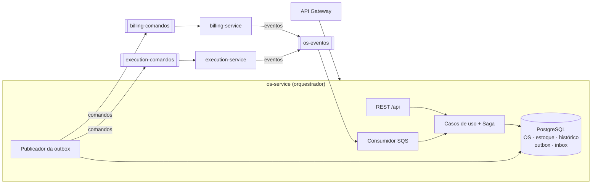
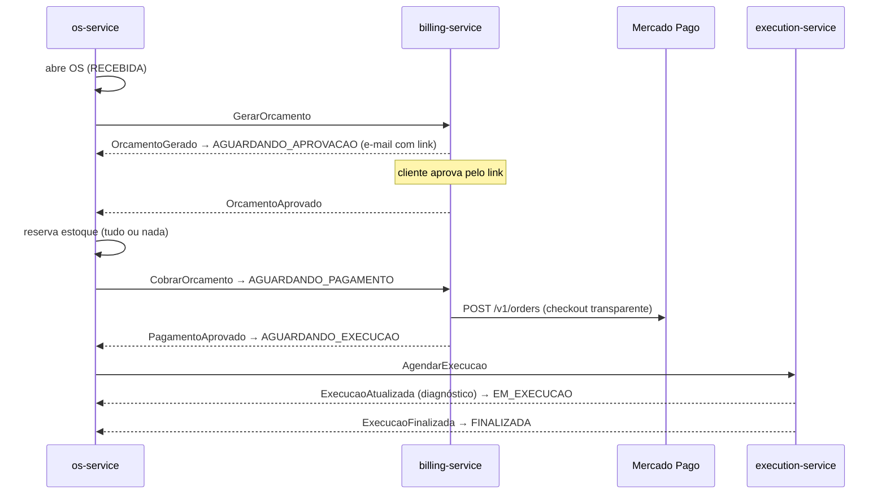
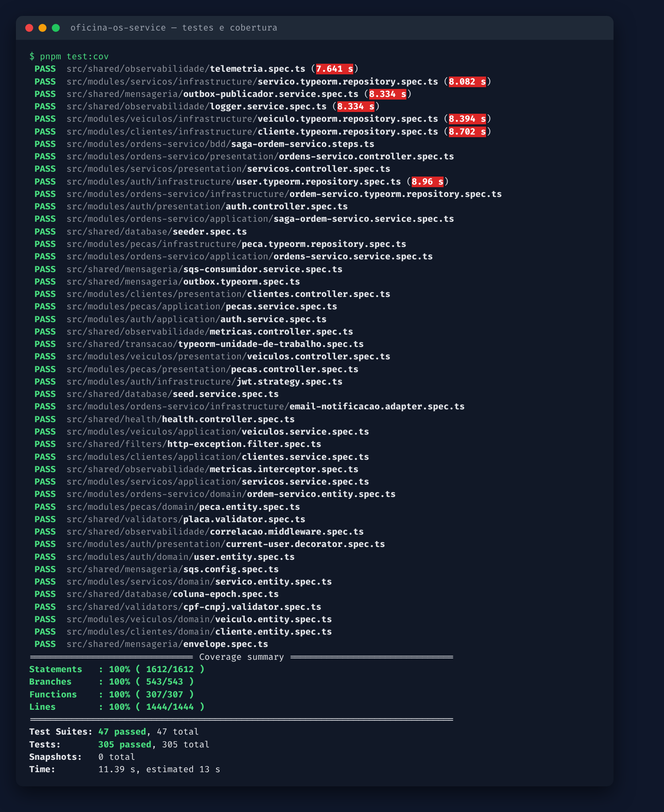
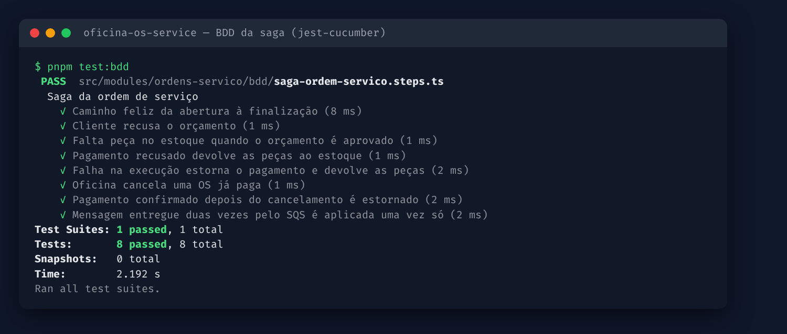
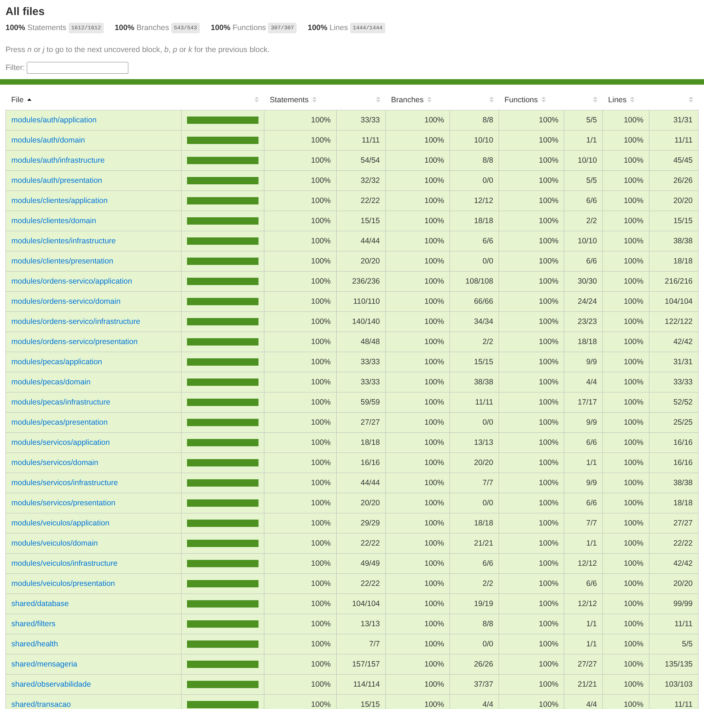

# oficina-os-service

**Ordem de Serviço e orquestrador da Saga** do Sistema Integrado de Atendimento e Execução de Serviços — Tech Challenge SOAT, Fase 4.

Dono da ordem de serviço do começo ao fim: abre a OS, guarda o estado da saga, manda comandos para o [billing-service](https://github.com/fdacmatheus/oficina-billing-service) e o [execution-service](https://github.com/fdacmatheus/oficina-execution-service), reage aos eventos deles e, quando algo falha, decide e dispara as compensações. Também mantém os cadastros (clientes, veículos, catálogo de serviços e peças) e o **estoque**.

## Tecnologias

- **NestJS 11** + **TypeScript** (strict), Clean Architecture em 4 camadas
- **PostgreSQL 16** (banco próprio, Amazon RDS) + **TypeORM** com migrations
- **Amazon SQS** (fila de entrada `os-eventos` + DLQ) com **outbox** e **inbox** transacionais
- **OpenTelemetry** (traces e logs OTLP) · **prom-client** (métricas) · logs JSON com `correlationId`
- **Jest** + **jest-cucumber** (BDD) — 305 testes, **100% de cobertura**
- **Docker** · **Kubernetes** (EKS, HPA) · **Terraform** · **GitHub Actions** (gitleaks, CodeQL)

## Arquitetura



Nenhum serviço lê o banco de outro: tudo que o billing e o execution precisam (cliente, itens, veículo) vai dentro do comando.

## A Saga: orquestrada

O fluxo transacional da OS é coordenado por **orquestração**: o os-service é o orquestrador central. Ele guarda o estado da saga junto com a própria OS, envia **comandos** e recebe **eventos**. O billing e o execution não conversam entre si; só executam o comando e respondem.



### Por que orquestração e não coreografia

| Critério | Orquestração (escolhida) | Coreografia |
|---|---|---|
| Onde está o fluxo | Num lugar só: `SagaOrdemServicoService`, um `switch` por evento | Espalhado: cada serviço reage aos eventos dos outros |
| Compensação | O orquestrador sabe em que etapa a OS estava e dispara exatamente o que precisa ser desfeito | Cada serviço teria de saber quem desfazer, criando dependências cruzadas |
| Rastreio | Histórico da OS e métricas de compensação num só serviço | Precisa juntar o estado de vários serviços para entender uma OS |
| Acoplamento | O orquestrador conhece os demais (aceitável com 3 serviços e fluxo linear) | Menor acoplamento direto, maior acoplamento implícito por eventos |

Com um fluxo linear e compensações que dependem do estado, a orquestração deixa a regra explícita, testável e fácil de demonstrar.

### Compensações

| Falha | O orquestrador faz | Estado final |
|---|---|---|
| Cliente recusa o orçamento | — | CANCELADA |
| Falta peça ao reservar | devolve o que já reservou + `CancelarOrcamento` | CANCELADA |
| Pagamento recusado | libera o estoque | CANCELADA |
| Execução falha | libera o estoque + `EstornarPagamento` (refund no Mercado Pago) | CANCELADA |
| Oficina cancela a OS | conforme a etapa: estoque, `CancelarOrcamento`, `EstornarPagamento`, `CancelarExecucao` | CANCELADA |
| Pagamento chega depois do cancelamento | `EstornarPagamento` | CANCELADA |
| Execução agendada depois do cancelamento | `CancelarExecucao` | CANCELADA |

### Garantias de consistência

- **Outbox transacional**: a mudança da OS, o estoque, o histórico e o comando a enviar são gravados na **mesma transação** Postgres. Um publicador envia ao SQS depois (`FOR UPDATE SKIP LOCKED`, várias réplicas em paralelo). Se o processo cair entre o commit e o envio, nada se perde.
- **Inbox idempotente**: o SQS entrega *at least once*; cada `messageId` é registrado na mesma transação do efeito, e a repetição é descartada.
- **Bloqueio por OS**: cada evento lê a OS com `SELECT ... FOR UPDATE`, então dois eventos da mesma OS nunca são aplicados ao mesmo tempo.
- **Fora de ordem**: o SQS padrão não garante ordem; um evento que não faz sentido no estado atual é registrado no histórico e ignorado (ex.: `ExecucaoFinalizada` antes de `ExecucaoAtualizada` é aceita).
- **Estoque tudo ou nada**: a reserva é um `UPDATE ... WHERE estoque >= :qtd` por peça; se uma falta, as já reservadas voltam na mesma transação.
- **DLQ**: erro técnico não apaga a mensagem; após 5 tentativas ela vai para `os-eventos-dlq`.

Formato de todas as mensagens: [CONTRATO-MENSAGENS.md](docs/CONTRATO-MENSAGENS.md).

## Estados da OS

```
RECEBIDA → AGUARDANDO_APROVACAO → AGUARDANDO_PAGAMENTO → AGUARDANDO_EXECUCAO → EM_EXECUCAO → FINALIZADA → ENTREGUE
qualquer estado antes de FINALIZADA → CANCELADA (com compensação)
```

Todas as datas são **Unix epoch em milissegundos** (`number`), na API, nas mensagens e no banco (`bigint`).

## API

Swagger em `/docs`. Rotas principais (prefixo `/api`):

| Método | Rota | Descrição |
|---|---|---|
| `POST` | `/auth/login` | Login administrativo (JWT) |
| `CRUD` | `/clientes`, `/veiculos`, `/servicos`, `/pecas` | Cadastros e estoque |
| `POST` | `/ordens-servico` | Abre a OS e inicia a saga |
| `GET` | `/ordens-servico` · `/ordens-servico/:id` | Lista (por prioridade) e detalhe com o estado da saga |
| `GET` | `/ordens-servico/:id/historico` | Linha do tempo: cada evento da saga e o status resultante |
| `PATCH` | `/ordens-servico/:id/entregar` | FINALIZADA → ENTREGUE |
| `PATCH` | `/ordens-servico/:id/cancelar` | Cancela e dispara as compensações |
| `GET` | `/publico/ordens-servico/:numero` | Consulta do cliente (sem JWT): status e histórico |
| `GET` | `/health` · `/metrics` | Probes e Prometheus |

Collection: [postman/oficina-os-service.postman_collection.json](postman/oficina-os-service.postman_collection.json).

## Como rodar

Pré-requisitos: Docker, Node 22, pnpm 12. A infraestrutura local (Floci emulando SQS/DynamoDB, Postgres de cada serviço, MailHog e a stack de observabilidade) fica no repositório [oficina-fase4-infra](https://github.com/fdacmatheus/oficina-fase4-infra), pasta `local/`.

```bash
# 1. infra local (no repositório de infra)
docker compose -f local/docker-compose.yml up -d

# 2. este serviço
cp .env.example .env   # e gere JWT_SECRET, JWT_REFRESH_SECRET e ADMIN_PASSWORD
docker compose up -d --build        # ou: pnpm install && pnpm start:dev
```

API em `http://localhost:3001/api`, Swagger em `http://localhost:3001/docs`. A saga inteira, com os 3 serviços, roda com `local/demo-saga.sh` no repositório de infra (`feliz`, `pagamento`, `execucao`, `recusa`).

## Testes

```bash
pnpm test        # unitários + BDD
pnpm test:bdd    # só o BDD
pnpm test:cov    # com cobertura (falha abaixo de 95%)
```

**BDD**: [`saga-ordem-servico.feature`](src/modules/ordens-servico/bdd/saga-ordem-servico.feature), em português, com 8 cenários do fluxo completo: caminho feliz, orçamento recusado, falta de estoque, pagamento recusado, falha na execução com estorno, cancelamento pela oficina, pagamento depois do cancelamento e mensagem duplicada.

### Evidências de cobertura







O mínimo de 95% está travado no `coverageThreshold` do Jest: o CI falha abaixo disso. Ficam fora da medição apenas bootstrap (`main.ts`, `tracing.ts`), `*.module.ts`, DTOs, migrations e os fakes de teste.

## Observabilidade

- **Métricas** (`/api/metrics`, Prometheus): transições de status, compensações por motivo, mensagens da saga por tipo e resultado (aplicada, ignorada, duplicada), mensagens publicadas, outbox pendente, latência e erros HTTP.
- **Traces** (OpenTelemetry → Tempo): o `traceparent` W3C viaja dentro do envelope de cada mensagem, então uma ação atravessa os-service → billing → execution num único trace. Os spans `publicar <Tipo>` e `processar <Tipo>` carregam o atributo `oficina.os_id`.
- **Logs** JSON com `correlationId` (= id da OS) no console e via OTLP para o Loki, já com `trace_id`.
- Dashboard **Oficina · Saga distribuída** no Grafana, versionado no repositório de infra.

Liga com `OTEL_EXPORTER_OTLP_ENDPOINT`; sem ela (testes, CI) o tracing fica desligado.

## Infraestrutura e CI/CD

- `infra/` (Terraform): RDS PostgreSQL próprio (sem IP público, senha gerada → Secrets Manager `oficina/os/database`) e a fila `os-eventos` + DLQ.
- `k8s/`: Deployment (2 réplicas, probes, não-root), Service, HPA 2–6 por CPU, ConfigMap. O Secret não é versionado: o pipeline o monta a partir do Secrets Manager.
- `.github/workflows/ci-cd.yml`: em PR e push na `main` → lint, testes com cobertura, build, **gitleaks**, docker build. Na `main` com `DEPLOY_ENABLED=true` → imagem no ECR com a tag do commit, Secret, `kubectl apply` e `rollout status`.
- `.github/workflows/codeql.yml`: análise estática de qualidade e segurança (CodeQL) em todo PR.
- `main` protegida: merge só por PR com os checks verdes.

## Estrutura

```
src/
├── modules/
│   ├── ordens-servico/
│   │   ├── domain/          OrdemServico, StatusOS, compensações, histórico
│   │   ├── application/     SagaOrdemServicoService (orquestrador), OrdensServicoService
│   │   ├── infrastructure/  TypeORM, e-mail
│   │   ├── presentation/    controllers, DTOs, presenter
│   │   └── bdd/             feature + steps do BDD
│   ├── clientes/ veiculos/ servicos/ pecas/ auth/
└── shared/
    ├── mensageria/          envelope, outbox, inbox, publicador, consumidor SQS
    ├── transacao/           unidade de trabalho (transação compartilhada entre repositórios)
    ├── observabilidade/     métricas, logger, correlação, OpenTelemetry
    └── database/            migrations, seed, coluna epoch (ms)
```
